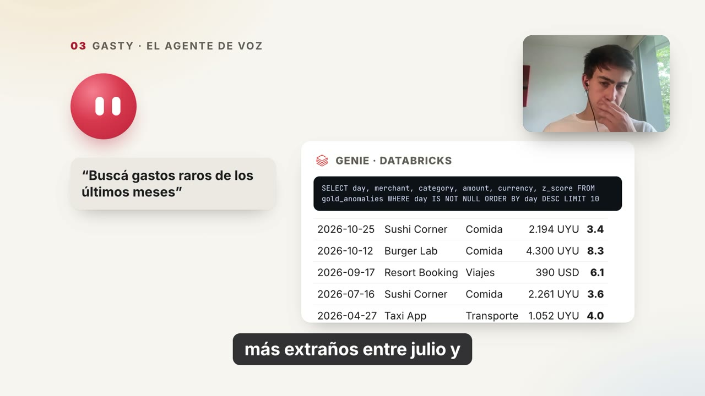
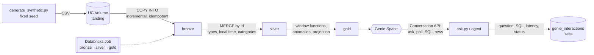

# Gasty · a voice agent for my spending, on Databricks

[](https://mateobartaburu.com)

**[▶ Watch the demo (1:27)](https://mateobartaburu.com)**

I talk to **Gasty** in real time and it answers with my numbers. The voice agent runs on the OpenAI Realtime API and hands
each question to **Databricks Genie**, which writes the SQL over a bronze, silver and gold pipeline. Bank notification emails
flow in on their own, and a weekly digest built with SQL on the gold tables lands in iMessage.

This repository holds the **Databricks side**: a medallion pipeline on **Databricks Free Edition**, queried in natural
language through Genie over its Conversation API, with every interaction logged to Delta. All data here is **synthetic**:
generated from scratch with a fixed seed, never derived from real transactions.



## What is implemented (and tested)
- **Generator** (`generate_synthetic.py`): ~1k movements over 13 months, UYU and USD, fixed monthly expenses, income, monthly FX,
  planted anomalies, statement lines that never arrived by email, missing amounts, and 5 held-back days to simulate a feed.
  Tests prove determinism and that no PII-like pattern (emails, card-length numbers, API-key shapes) leaks (`tests/test_synthetic.py`).
- **Pipeline** (`sql/`, `run_pipeline.py`): bronze with `COPY INTO` (idempotent), silver with `MERGE` (reprocessing never duplicates),
  13 gold tables (rolling 30-day windows, month-to-date comparison, z-score anomalies, projection, recurring payments,
  income vs spend, bank-statement reconciliation).
- **Incremental loads**: `python3 databricks/run_pipeline.py --advance` uploads the next day and reprocesses; `--reset` starts over.
- **Job** (`create_job.py`): notebooks published to the workspace and a serverless Job with three dependent tasks.
- **Genie** (`genie_space.py`, `genie_client.py`, `ask.py`): a Space over the gold tables with business instructions and certified
  example queries; a client for the Conversation API that returns the generated SQL and rows and logs each call.

## Run it
```bash
python3 databricks/generate_synthetic.py
python3 databricks/run_pipeline.py          # initial load + layers
python3 databricks/create_job.py            # notebooks + Job
python3 databricks/genie_space.py           # Genie Space
python3 databricks/ask.py "Were there any unusual expenses recently?"
```
Credentials: host in `config.json`, personal access token in the macOS Keychain (`databricks/setup_databricks.sh`). Nothing is stored in the repo.

## Honest scope
Built with plain SQL and Python. The voice agent, the Gmail ingestion and the iMessage digest live in a private app because
they also run on my real finances; in demo mode that app only talks to Genie over this synthetic dataset, which is what the
video shows. **Not implemented yet:** dbt, Airflow, Delta Live Tables / Lakeflow expectations.
For this data volume SQLite or Postgres would be enough; Databricks is used here to practice a real architecture.
Free Edition: serverless only, no commercial use.
